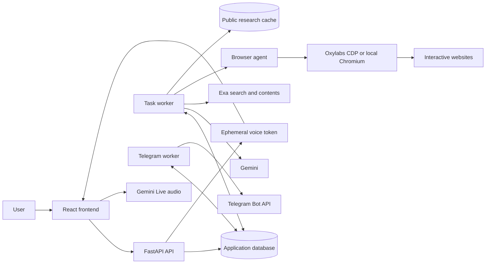

# Architecture

[Documentation index](README.md)

## Services and data flow



The frontend serves conversation and task controls. FastAPI authenticates requests, reads and writes owner-scoped state, issues voice tokens, and streams run updates. The task worker claims durable jobs and executes model, retrieval, and browser work. A separate optional Telegram worker handles account-link events and queued notifications.

The base Compose stack serves the built frontend through Nginx; the development override runs Vite. Both proxy `/api` to the backend. The alternative [Runtime image](aiven-runtime.md) serves built assets through `app.web` and supervises the API and workers in one container. The browser's embedded remote preview is read-only; its separate live-view link opens the interactive provider viewer.

## Request lifecycle

1. The client submits a message with a UUID `request_id`, research mode, timezone, optional attachments, and optional browser override.
2. The API validates ownership and persists a queued run. Reusing the same request ID with the same payload returns the existing run; conflicting reuse is rejected.
3. The supervisor claims the run and starts a child worker process. Only one queued or running run is allowed per conversation, and the current supervisor limits running tasks to two.
4. Routing selects chat, research, browser, or clarification. Explicit actions and browser choices can bypass model classification. Low-confidence routing uses local rules; model service failures have a classifier fallback.
5. Research pins a task contract, retrieves evidence, generates and verifies an answer, and refines gaps within its mode budget. Browser work observes a live page and calls bounded interaction tools, pausing for input or approval when needed.
6. Checkpointed answers and live progress persist in the database. Server-sent events expose state changes to the frontend.
7. The final exchange is stored with its sources. A successful browser reply can reserve the same page briefly for a follow-up in the same chat.

Recurring tasks use the same run queue but enter the scheduled research/evaluation path. Supported, new matches create a conversation update and inbox notification; enabled Telegram delivery is queued transactionally with the notification.

## Persistence

The supplied deployment stores application data in `/data/chats.sqlite3` in the shared `chats-data` volume. Local processes default to `runtime/chats.sqlite3`. The connection layer also accepts a PostgreSQL `DATABASE_URL`; it is not provisioned by the supplied Compose file.

| Data | Storage and behavior |
|---|---|
| Conversations and messages | Owner-scoped chats, sources, attachments, pin state, and search index |
| Accounts | User IDs, Argon2 password hashes, hashed magic links and sessions, and login throttling |
| Runs | Queued work, phase, status, request IDs, checked results, debug history, and live output |
| Browser state | Steps, pending requests, actions, encrypted saved logins, leases, and warm reservations |
| Recurring tasks | Instructions, interval, next check, run history, event keys, and inbox notifications |
| Telegram | Link attempts, confirmed links, poller lease, and delivery queue |
| Public evidence cache | Separate SQLite file containing pages, seller policies, and semantic verifier verdicts |
| Exa request accounting | Optional separate SQLite ledger |

SQLite connections enable foreign keys, WAL journaling, and secure deletion. PostgreSQL uses a connection adapter, ordered identity columns, full-text search, and transaction advisory locking for serialized read/modify/write operations. Store initialization creates or extends schemas. There is no bundled SQLite-to-PostgreSQL data migration command.

Warm reservations coordinate follow-up ownership, but the live browser connection itself lives in the worker process. Restarting the worker cannot restore that connection. Saved authentication state is a separate persistent feature.

## Backend module map

| Module | Responsibility |
|---|---|
| [`main.py`](../backend/app/main.py), [`schemas.py`](../backend/app/schemas.py) | App assembly, chat/run/browser endpoints, request and response models |
| [`auth.py`](../backend/app/auth.py), [`accounts.py`](../backend/app/accounts.py) | Request authentication, account provisioning, session and magic-link management |
| [`database.py`](../backend/app/database.py), [`store.py`](../backend/app/store.py) | Database connections, schema setup, chat persistence, and search |
| [`runs.py`](../backend/app/runs.py), [`streaming.py`](../backend/app/streaming.py) | Durable runs, idempotency, checkpoints, and SSE |
| [`worker.py`](../backend/app/worker.py) | Scheduling, process supervision, routing, deadlines, and browser reuse |
| [`orchestration/`](../backend/app/orchestration/) | Task interpretation, planning, refinement, grounding, and verification |
| [`research.py`](../backend/app/research.py), [`source_cache.py`](../backend/app/source_cache.py) | Exa HTTP calls, content normalization, freshness, and caches |
| [`research_modes.py`](../backend/app/research_modes.py), [`model_selection.py`](../backend/app/model_selection.py) | Shared budgets and stage-model selection |
| [`browser/`](../backend/app/browser/) | CDP/local connections, DOM observations, actions, approvals, cookie import, and session leases |
| [`tasks.py`](../backend/app/tasks.py), [`task_worker.py`](../backend/app/task_worker.py) | Recurrence, alert evaluation, and deduplication |
| [`telegram.py`](../backend/app/telegram.py), [`telegram_worker.py`](../backend/app/telegram_worker.py) | Linking, delivery queue, polling, retries, and uncertain-send handling |
| [`transcription.py`](../backend/app/transcription.py) | Constrained Gemini Live token creation |
| [`attachments.py`](../backend/app/attachments.py), [`secrets.py`](../backend/app/secrets.py) | Attachment validation and configured-secret redaction |

## Frontend module map

| Module | Responsibility |
|---|---|
| [`App.tsx`](../frontend/src/App.tsx) | Conversation, account, run, and panel state |
| [`components/`](../frontend/src/components/) | Composer, messages, sidebar, run/browser activity, tasks, Telegram, and saved logins |
| [`chatApi.ts`](../frontend/src/chatApi.ts), [`runStream.ts`](../frontend/src/runStream.ts) | Conversation/run requests and streaming updates |
| [`browserApi.ts`](../frontend/src/browserApi.ts), [`useBrowserRequest.ts`](../frontend/src/useBrowserRequest.ts) | Browser controls and pending-request lifecycle |
| [`taskApi.ts`](../frontend/src/taskApi.ts), [`telegramApi.ts`](../frontend/src/telegramApi.ts) | Recurring task and Telegram clients |
| [`useVoiceInput.ts`](../frontend/src/useVoiceInput.ts), [`voiceTranscription.ts`](../frontend/src/voiceTranscription.ts) | Microphone capture, ephemeral-token sessions, and draft transcription |
| [`cookie-helper/`](../frontend/cookie-helper/) | Optional site-scoped cookie export extension |

The conversation uses assistant-ui primitives. `react-markdown` and `remark-gfm` render replies. Backend `markdown-it-py` parsing serves a different purpose: extracting and checking source passages for research.

## Data handling and action boundaries

Named account IDs scope private application data. The optional bearer token maps to a single shared owner. Cookie-authenticated mutations require `X-Guuey-Request: 1`; an optional `X-Guuey-User` header prevents a stale tab from operating as a different account.

Website logins and private browser responses use AES-GCM with a server-held key and associated owner/request or session metadata. Consumed, cancelled, and expired private responses are cleared. Ordinary chat, attachments, source text, and run diagnostics remain application records; saved-login encryption does not encrypt the whole database.

Gemini receives task context and the content needed for model work. Exa receives research queries and requested URLs. The remote browser provider hosts the live website session. Dictation audio travels directly from the frontend to Gemini Live using an ephemeral token; Guuey does not save audio recordings. Telegram receives the notification excerpt and links for tasks the user enabled.

Attachments and retrieved pages are untrusted reference data. Browser navigation checks reject credentials in URLs, IP literals, and local/private hostname forms. Final-action checks, page/target matching, action records, and fresh confirmation observations reduce accidental or repeated submissions. Detection is heuristic and website-dependent; an uncertain result blocks further submissions on that site until the owner resolves it.

## Runtime entrypoint

[`Dockerfile.aiven`](../Dockerfile.aiven) builds the frontend and backend together.
Build it from the repository root with:

```sh
docker build -f Dockerfile.aiven -t guuey:runtime .
```

[`runtime_start.py`](../backend/app/runtime_start.py) requires a PostgreSQL URL and,
outside local testing, `DATABASE_SSLMODE=verify-full` plus a CA certificate. It can
decode `AIVEN_CA_CERT_BASE64` into `/tmp/guuey-postgres-ca.pem` with mode 0600 and
set `PGSSLROOTCERT`. Database initialization retries operational errors up to 30
times with two-second delays. A fresh database without a valid shared token needs
bootstrap credentials; startup creates the password account and removes those
credential variables before starting child processes. It does not reset existing
accounts or generate a magic link.

[`supervisord.conf`](../deploy/supervisord.conf) starts `app.web:app` on port 8000,
the task worker, and optionally Telegram when `TELEGRAM_ENABLED=true`. Logs go to
stdout/stderr. Failed processes restart; a fatal-event listener stops the container
when startup retries are exhausted. The health check calls `/api/health`.

The image serves assets from `/app/static` and keeps its disposable research cache
under `/tmp`. Application records persist in PostgreSQL. `LOCAL_DEVELOPMENT=true`
skips mandatory TLS-mode/CA checks in the entrypoint but does not change database
connection settings itself. The [Aiven guide](aiven-runtime.md) covers hosted setup;
`compose.aiven.yaml` contains integration placeholders and is not a ready-to-run
local PostgreSQL stack.

## Recovery and scaling limits

At startup, the active worker marks existing running jobs as interrupted and clears warm browser reservations. Preserve checkpointed results and inspect uncertain browser actions after an interruption. PostgreSQL uses an advisory coordinator lock so a replacement worker waits for the current coordinator before recovery and scheduling. SQLite has no equivalent coordinator lock: run only one supervisor against a SQLite database. The two-task concurrency limit is not a distributed worker pool.

Telegram workers coordinate through a database lease and can elect one poller. This is separate from task-worker supervision. Research caches can be regenerated, while application records and `BROWSER_SESSION_KEY` require deliberate backup and retention. See [operations](operations.md).
